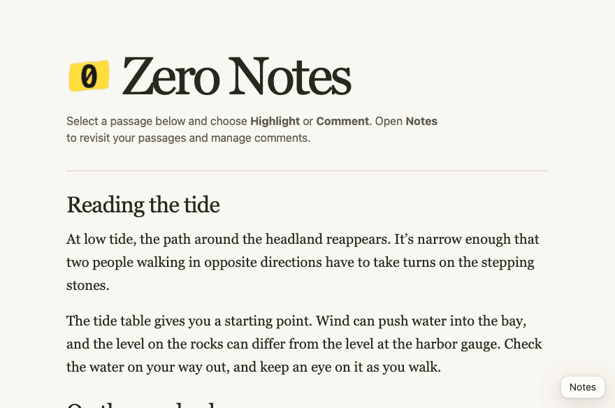

#  Zero Notes

Highlight text and leave comments. Notes stay in your browser.

[Install from the Chrome Web Store](https://chromewebstore.google.com/detail/zero-notes/mjabdjgldanojgmehoiihcbkafkhobbh) · [Try the live demo](https://madsolame.com/zero-notes/) · [How To](https://madsolame.com/zero-notes/help.html)

[Privacy policy](privacy.html) · [MIT License](LICENSE)



## Chrome extension

After installing, open Zero Notes on a page you want to annotate. Click **Enable** and approve access for that site. Saved highlights appear automatically on enabled sites. Press <kbd>Alt</kbd>+<kbd>Shift</kbd>+<kbd>N</kbd> to turn notes on or off for the current site; change the shortcut at `chrome://extensions/shortcuts`.

To try a development build, open `chrome://extensions`, turn on **Developer mode**, choose **Load unpacked**, and select the `chrome-extension/` folder.

## Read notes from the terminal

Use Google Chrome on macOS or Linux and Go 1.22 or later. From this repo, register the helper for the Chrome Web Store installation.

```sh
go build -o zero-notes ./cli
./zero-notes install mjabdjgldanojgmehoiihcbkafkhobbh
```

For an unpacked build, substitute its ID from the Zero Notes card at `chrome://extensions` in the profile with your notes.

The installer registers the helper with Chrome and prints the registration path. If **Connect CLI** is missing, reload the extension from its card at `chrome://extensions`. Then click **Connect CLI** in the popup and approve Native Messaging.

```sh
./zero-notes list --site https://example.com
```

Zero Notes reads saved notes through its extension API and returns JSON for the requested site. During a connection, processes running as your OS user can query notes for any site by passing its URL. The original pages can be closed. Connect one Chrome profile at a time. Click **Disconnect CLI** to turn off access. The connection starts off each time Chrome opens.

If Chrome uses a custom data directory, find **Profile Path** at `chrome://version` and run `./zero-notes install --user-data-dir "/path/to/user-data" EXTENSION_ID` with the parent of that path. If the popup says **Native host not found**, check the printed registration path and extension ID. Then fully quit and reopen Chrome before reconnecting.

## Embed in HTML

Copy `local-text-notes.js` next to your HTML file and add:

```html
<script defer src="./local-text-notes.js"></script>
```

Select text to highlight or comment. Choose **Show notes** to see highlights and expand comment threads beside the page.
Use the copy button in the notes header to copy every note on the page as Markdown.
