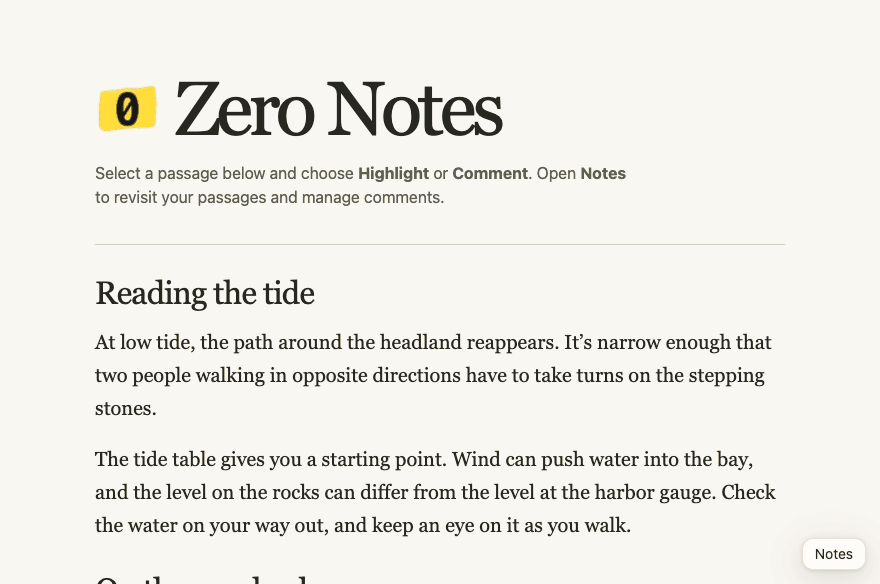

#  Zero Notes

Highlight text and leave comments. Notes stay in your browser.

[Try the live demo](https://madsolame.com/zero-notes/)



## Chrome extension

1. Open `chrome://extensions` and turn on **Developer mode**.
2. Choose **Load unpacked** and select the `chrome-extension/` folder.
3. Open the extension on a page and click **Enable on this site**. Saved highlights appear automatically on enabled sites.

## Read notes from the terminal

Use Google Chrome on macOS or Linux and Go 1.22 or later. Copy the ID from the Zero Notes card at `chrome://extensions` in the profile with your notes. Run this from the repo, replacing `EXTENSION_ID` with that ID.

```sh
go build -o zero-notes ./cli
./zero-notes install EXTENSION_ID
```

For a custom browser data directory, find **Profile Path** at `chrome://version` and pass its parent with `--user-data-dir`. The installer also has an Arc registration option on macOS, `./zero-notes install --browser arc EXTENSION_ID`, using the ID from `arc://extensions`. The live connection has been verified in Chrome.

The installer copies the helper to your application config directory and prints the registration path. If **Connect CLI** is missing, reload the existing extension from its extensions card so it keeps the same ID. Click **Connect CLI** in the popup and approve Native Messaging.

```sh
./zero-notes list --site https://example.com
```

Zero Notes reads saved notes through its extension API and returns JSON for the requested site. During a connection, processes running as your OS user can query notes for any site by passing its URL. The original pages can be closed. Connect one browser profile at a time. Click **Disconnect CLI** to turn off access. The connection starts off each time the browser opens.

If the popup says **Native host not found**, check that the installer used the same browser and extension ID. For a custom profile, compare the printed registration path with the browser’s version page. If the registration is correct, fully quit and reopen the browser before reconnecting.

## Embed in HTML

Copy `local-text-notes.js` next to your HTML file and add:

```html
<script defer src="./local-text-notes.js"></script>
```

Select text to highlight or comment. Open **Notes** to see your highlights and manage comments.
